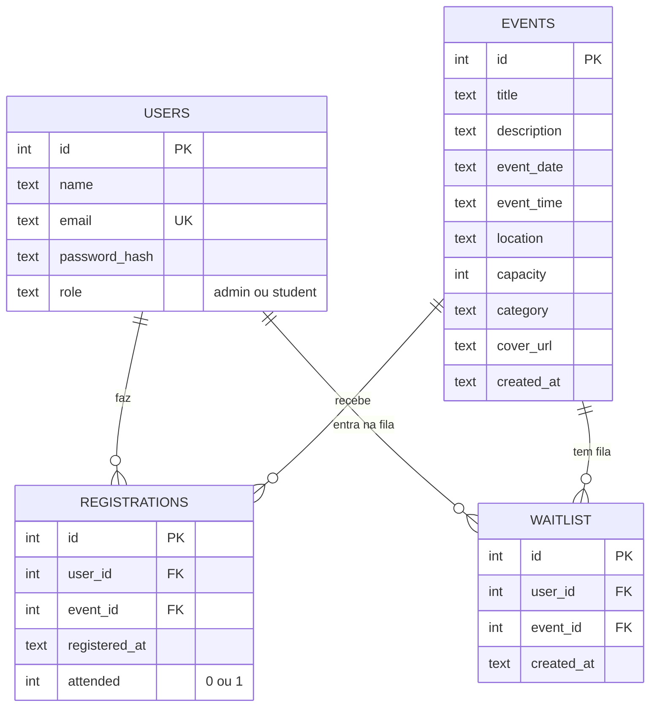

# EventManager

Sistema web para gerenciar eventos escolares: o público vê a agenda, os alunos se inscrevem (com lista de espera), os administradores cadastram eventos, controlam presença e acompanham gráficos.
Feito com **Python + Flask + SQLite**, sem frameworks de front-end.

> Guia completo para estudar o código: [`docs/GUIA_DE_ESTUDO.md`](docs/GUIA_DE_ESTUDO.md) ·
> Diagrama do banco em imagem: [`docs/diagrama_banco.svg`](docs/diagrama_banco.svg)

## Funcionalidades

**Público (sem login)**
- Página inicial com os próximos eventos e apresentação do sistema

**Alunos**
- Cadastro, login e **"esqueci minha senha"** (link assinado que vale 1 hora)
- Busca e filtros por categoria e período, com **paginação**
- Inscrição, **cancelamento** e **lista de espera** (a vaga liberada vai para o primeiro da fila)
- **Adicionar ao calendário** (Google Agenda ou arquivo `.ics` para Apple/Outlook)
- Certificados para imprimir ou salvar em PDF
- Página **Minha conta**: alterar nome, senha e excluir a conta

**Administradores**
- Cadastro/edição/exclusão de eventos com categoria e **capa por upload** (ou link)
- Controle de presença e visão da lista de espera de cada evento, com **exportação em CSV** (abre no Excel)
- **Gerenciar usuários**: buscar contas, tornar alguém administrador (ou aluno) e excluir contas
- Painel com **gráficos e estatísticas**
- Criação de administradores com código secreto (`ADMIN_CODE`)

**Em todo o sistema**
- Tema claro/escuro, layout para celular e **acessibilidade** (teclado, leitores de tela, contraste)
- **Segurança reforçada**: token CSRF em todos os formulários, limite de tentativas de login e de pedidos de recuperação de senha, logout por POST

## Estrutura do projeto

```
app.py                  ponto de entrada (gunicorn app:app)
manage.py               comandos de manutenção (criar admin, remover contas fictícias...)
eventmanager/
  __init__.py           create_app(): monta tudo (configuração, logs, blueprints, erros)
  config.py             configurações e variáveis de ambiente
  db.py                 conexão com o SQLite + migrações versionadas
  security.py           login_required / admin_required
  csrf.py               token anti-CSRF dos formulários
  ratelimit.py          limite de tentativas (login e recuperação de senha)
  users.py              regras compartilhadas de contas (excluir usuário e liberar vagas)
  queries.py            consultas SQL compartilhadas (eventos, estatísticas)
  helpers.py            datas, busca, paginação, validação do formulário de evento
  uploads.py            upload seguro de capas
  calendar_utils.py     arquivo .ics e link do Google Agenda
  waitlist.py           regras da lista de espera
  mailer.py             envio de e-mail (SMTP) ou registro no log
  blueprints/           main (início e painel) · auth · events · account · admin (usuários)
templates/              páginas HTML (Jinja2)
static/                 css/ js/ uploads/
tests/                  testes automáticos
docs/                   guia de estudo e diagrama do banco
```

## Como rodar localmente

```bash
pip install -r requirements.txt
python app.py
```

Abra http://127.0.0.1:5000. O banco `eventmanager.db` é criado e atualizado automaticamente.
Como não existem mais contas fictícias, crie o primeiro administrador de um destes jeitos:

```bash
# 1) pelo terminal
python manage.py create-admin seu@email.com "Seu Nome"

# 2) pelo site: defina ADMIN_CODE e use o campo "Código de administrador" no cadastro
export ADMIN_CODE="um-codigo-secreto"     # Windows (PowerShell): $env:ADMIN_CODE="um-codigo-secreto"
```

## Testes

```bash
python -m unittest discover -s tests -t . -v      # não precisa instalar nada
# ou, se tiver o pytest:  pip install -r requirements-dev.txt && pytest
```

## Variáveis de ambiente

| Variável | Para que serve |
| --- | --- |
| `SECRET_KEY` | Chave que assina sessões e links de recuperação. **Obrigatória em produção** (texto longo e aleatório) |
| `SECURE_COOKIES` | Use `1` em produção (HTTPS): o cookie de sessão só trafega por conexão segura. Deixe sem definir ao rodar localmente em `http://` |
| `LOGIN_MAX_ATTEMPTS`, `LOGIN_LOCK_MINUTES` | Tentativas de login erradas permitidas (padrão 5) e tempo de bloqueio em minutos (padrão 10) |
| `ADMIN_CODE` | Código para criar administradores no cadastro. Sem ele, o campo não aparece |
| `DATABASE_PATH` | Caminho do arquivo do banco (padrão: `eventmanager.db` na raiz) |
| `SMTP_HOST`, `SMTP_PORT`, `SMTP_USER`, `SMTP_PASSWORD`, `MAIL_FROM`, `SMTP_TLS` | E-mail para recuperação de senha e avisos da lista de espera. Sem `SMTP_HOST`, o texto do e-mail (com o link) é gravado no log |
| `LOG_DIR`, `LOG_LEVEL` | Pasta e nível dos logs (padrão: `logs/` e `INFO`) |

## Manutenção (`manage.py`)

```bash
python manage.py create-admin ana@email.com "Ana Souza"   # cria um administrador
python manage.py reset-password ana@email.com             # define nova senha (quem ficou sem acesso)
python manage.py remove-demo                              # remove as contas fictícias antigas
python manage.py list-users                               # lista as contas
python manage.py backup                                   # copia o banco para backups/ (mantém as 10 mais recentes)
```

## Publicação

- **PythonAnywhere:** `git pull` no console Bash, depois **Reload** na aba Web. As variáveis de ambiente ficam no arquivo WSGI (`os.environ['SECRET_KEY'] = '...'`, antes de `from app import app as application`).
- **Render:** Build `pip install -r requirements.txt` · Start `python -m gunicorn app:app --bind 0.0.0.0:$PORT` · variáveis em *Environment*. O disco gratuito é temporário (banco e uploads se perdem a cada reinício).

## Diagrama do banco de dados



- `registrations` e `waitlist` têm `UNIQUE(user_id, event_id)`: ninguém se inscreve (ou entra na fila) duas vezes no mesmo evento.
- `ON DELETE CASCADE`: excluir um usuário ou um evento remove automaticamente suas inscrições e posições na fila.
- A ordem da fila é o `id` crescente da tabela `waitlist` (quem entrou primeiro tem o menor `id`).
- `rate_limits` é uma tabela técnica, sem relações: registra tentativas de login e pedidos de recuperação de senha.
- Versão em imagem para slides: [`docs/diagrama_banco.svg`](docs/diagrama_banco.svg).

## Decisões técnicas

| Decisão | Alternativas | Por que esta escolha |
| --- | --- | --- |
| **Flask** | Django, FastAPI | Pequeno e explícito: cada rota, validação e consulta aparece no código, o que ajuda a aprender e a explicar na banca. Django traria muito mais estrutura pronta do que o projeto precisa. |
| **SQLite** | PostgreSQL, MySQL | Zero instalação, um único arquivo, suficiente para dezenas de usuários simultâneos. Para crescer, basta trocar o banco. |
| **SQL puro (`sqlite3`)** | SQLAlchemy (ORM) | O SQL fica visível e didático (JOIN, subconsultas, transações). Consultas sempre usam parâmetros (`?`, `:nome`), o que evita SQL injection. |
| **Fábrica de app + blueprints** | Um `app.py` gigante | O arquivo único passou de 500 linhas. Cada blueprint cuida de um assunto, e a fábrica `create_app` permite criar um app isolado para cada teste. |
| **Migrações próprias (`PRAGMA user_version`)** | Flask-Migrate/Alembic | Essas ferramentas exigem ORM. Aqui cada migração é uma função idempotente numerada; bancos antigos sobem de versão sozinhos ao iniciar, sem perder dados. |
| **Hash de senha (Werkzeug, scrypt)** | Guardar a senha, usar MD5/SHA simples | Só o hash é guardado, com sal e custo computacional alto. Nem o administrador do banco consegue ver as senhas. |
| **Link de recuperação assinado (`itsdangerous`)** | Tabela de tokens no banco | O link carrega o próprio dado assinado e a hora; não precisa de tabela. Inclui uma "impressão digital" da senha atual, então deixa de valer assim que a senha muda (uso único) e expira em 1 hora. |
| **Lista de espera em tabela própria** | Contador, coluna na inscrição | Uma tabela dedicada guarda a ordem de chegada. Promoção e cancelamento rodam na mesma transação, então nunca sobra vaga vazia com gente na fila. |
| **`BEGIN IMMEDIATE` nas inscrições** | Verificar e inserir sem travar | Trava a escrita durante "contar vagas → inserir", evitando que duas pessoas peguem a última vaga ao mesmo tempo. |
| **Upload em disco com validação por conteúdo** | Confiar na extensão, guardar no banco | Os primeiros bytes revelam o tipo real da imagem; o nome vem de um sorteio (nunca do usuário); limite de 3 MB; SVG não é aceito. |
| **Renderização no servidor (Jinja2)** | SPA com React/Vue | Menos código, funciona bem sem JavaScript, ótimo para acessibilidade, e o Jinja escapa HTML automaticamente (proteção contra XSS). |
| **CSS com variáveis (tema claro/escuro)** | Bootstrap, Tailwind | Um conjunto de cores por tema muda o site inteiro; cores conferidas para contraste WCAG AA. |
| **Token CSRF próprio + `SameSite=Lax`** | Flask-WTF | Duas camadas: o cookie não vai em envios vindos de outros sites e cada formulário POST carrega um token secreto da sessão (conferido em `before_request`). Poucas linhas, sem dependência extra, e o logout passou a ser POST. |
| **Limite de tentativas guardado no banco** | Contador em memória, Flask-Limiter | A tabela `rate_limits` vale para todos os processos do servidor e sobrevive a reinícios. O limite é por e-mail (e não por IP, que em hospedagens com proxy seria o mesmo para todos). |
| **Backup com a API do SQLite** | Copiar o arquivo | `manage.py backup` gera uma cópia consistente mesmo com o site em uso e apaga as mais antigas. |
| **CSV com `;` e BOM** | CSV com vírgula | O Excel em português abre com colunas e acentos certos; textos que começam com `=`, `+`, `-` ou `@` recebem um apóstrofo (evita injeção de fórmula). |
| **Testes com `unittest`** | pytest | Vem com o Python (nada para instalar) e também roda no pytest. |
| **E-mail por SMTP opcional** | Serviço externo obrigatório | Sem SMTP o sistema continua funcionando (o link vai para o log). Contas gratuitas do PythonAnywhere só falam SMTP com o Gmail. |

## Segurança (resumo)

Senhas com hash · consultas parametradas · HTML escapado · **token CSRF em todo formulário POST** · **limite de tentativas de login e de recuperação de senha** · logout por POST · cookie `HttpOnly` + `SameSite=Lax` (e `Secure` com `SECURE_COOKIES=1`) · sessão renovada no login · links de recuperação assinados, expiráveis e de uso único · resposta igual para e-mails existentes e inexistentes · upload validado pelo conteúdo · redirecionamentos só para o próprio site · cabeçalho `X-Content-Type-Options: nosniff` · o último administrador não pode se excluir · contas fictícias removidas.

## Acessibilidade (resumo)

Link "Pular para o conteúdo" · um `<h1>` por página · rótulos em todos os campos · `aria-current` no menu · avisos com `role="alert"/"status"` · barras de progresso com `role="progressbar"` · gráficos com texto equivalente · modal com foco preso e fechamento por Esc · tema escuro e cores com contraste mínimo de 4,5:1 · respeita "reduzir movimento" · alvos de toque de pelo menos 36 px.

## Limitações conhecidas e próximos passos

- Sem verificação de e-mail no cadastro e sem autenticação em dois fatores
- O bloqueio de login é por e-mail: alguém mal-intencionado pode travar a conta de outra pessoa por 10 minutos (o custo de não bloquear por IP)
- A duração do evento no calendário é fixa em 2 horas (o sistema só guarda o horário de início)
- Uploads ficam no disco do servidor (no Render gratuito eles se perdem)
- Próximos passos: verificação de e-mail, certificado com código de verificação, check-in por QR Code
